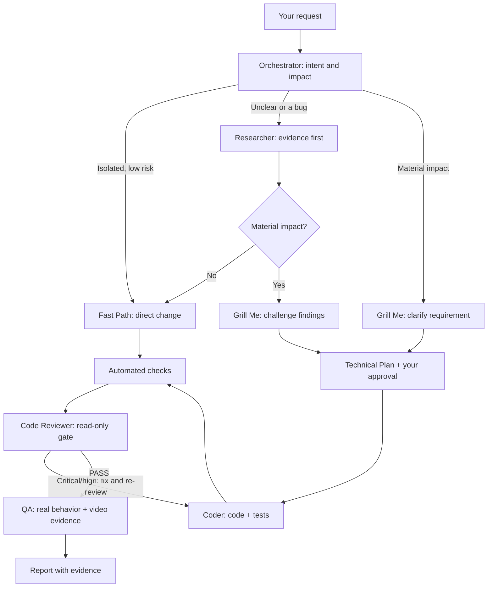

# Qark

An impact-aware AI development workflow for **Claude Code, Codex, and Antigravity**.

Qark is a set of instructions (a skill plus role specs), not an app or a runtime. It makes your coding agent work like a small, disciplined dev team: small safe edits go straight through, risky changes get a plan you approve first, and nothing is called "tested" unless it was actually run.

## What you get

- **Right-sized process.** Typo or wording fix: just do it. Change to business rules, data, security, or API contracts: research, a written plan, and your approval before any code.
- **A small team of roles.** Orchestrator, Researcher, Coder (code + tests), Code Reviewer, and QA, each with a clear job and clear limits.
- **Evidence over claims.** Work status and verification status are tracked separately. "Done" never means "passed".
- **Visible agents in Herdr.** Inside [Herdr](https://github.com/herdrdev/herdr), each specialist opens in its own pane so you can watch it work.
- **Video proof from QA.** Before/after video for UI changes, and a recorded run for CLI tests, via Playwright.

## Quick start

Pick your host. Qark then activates on ordinary development requests; you don't need to say "qark".

| Host | Install |
| --- | --- |
| **Claude Code** | `/plugin install qark --marketplace rifqicode/qark` (or `claude plugin marketplace add rifqicode/qark`, then `claude plugin install qark@qark`). Local checkout: `claude --plugin-dir ./qark` |
| **Codex** | `npx skills add rifqicode/qark --skill qark -g -a codex -y` |
| **Antigravity** | `agy plugin install https://github.com/rifqicode/qark` |

Then try a request without naming Qark, for example: *"add an endpoint that changes an order's status"*. You should see Qark ask clarifying questions and write a plan before touching code. For a tiny wording fix it should just make the change.

Notes: Claude Code loads it as a local plugin (not a published marketplace entry). The Codex path uses native skill discovery, not a guaranteed session-start hook. Qark is **not** claimed to be published in any marketplace. More detail: [installation](docs/installation.md) and [auto-activation](docs/auto-activation.md).

## How it works



The three paths:

| Path | When | What happens |
| --- | --- | --- |
| **Fast Path** | You explicitly asked, it is isolated, reversible, and low impact (wording, typo, presentation-only UI) | Inspect, change, run proportionate checks. No plan, no extra approval. |
| **Research** | Impact is unclear, or it is a bug / failing test | Read only what is relevant. For bugs, the optional `systematic-debugging` skill is used if installed; otherwise built-in evidence-first research. Then re-decide: Fast Path or plan. |
| **Impact Gate** | Touches business rules, data integrity, security, API/schema contracts, integrations, or architecture | Grill Me, then a Technical Implementation Plan saved to `<your-project>/.ai/plans/`, then **your approval** before significant implementation. |

Discussing or planning is never permission to edit.

## The team

| Role | Spec | Job |
| --- | --- | --- |
| **Orchestrator** | [orchestrator.md](agents/orchestrator.md) | Talks to you, owns the plan, delegates, tracks status, writes the final report. |
| **Researcher** | [researcher.md](agents/researcher.md) | Read-only investigation with file and symbol evidence. |
| **Coder** | [coder.md](agents/coder.md) | Implements the approved scope **and its tests** (test-first where feasible). A *test-only* mode, built from acceptance criteria without reading the implementation, can be used for high-risk areas (auth, payments, balances, migrations). |
| **Code Reviewer** | [code-reviewer.md](agents/code-reviewer.md) | Read-only static review of the integrated diff before QA. Critical/high findings block QA until fixed and re-reviewed, for at most 2 cycles; after that it escalates to you instead of looping. |
| **QA** | [qa.md](agents/qa.md) | Verifies real behavior with Playwright, browser, CLI, or API tools, independently of the Coder's claims. |

Shared rules live in [SKILL.md](SKILL.md) and [agent handoff and execution](docs/agent-handoff-and-execution.md).

## Quality gates

- **[Grill Me](docs/grill-me.md):** for unclear or high-impact work, the Orchestrator asks **one question at a time**, each with 2-4 options, trade-offs, and a recommendation. It shows a *readiness confidence %* (a transparent heuristic over five weighted dimensions, not a probability) and recalculates after each answer. 80% is never automatic approval. Skipped for routine Fast Path tasks.
- **[Code Reviewer](agents/code-reviewer.md):** a separate, read-only pass after automated checks and before QA.

## Visible agents with Herdr

When Qark runs **inside Herdr** and the official `herdr` skill is installed, planned specialist work is spawned **automatically** as separate CLI agents in new panes. You do not need to mention Herdr.

- Qark defines the protocol: agent names like `qark-coder-imp01`, a self-contained handoff prompt, a result file per task under `.ai/runs/`, file ownership, and verification. The Herdr skill supplies the actual commands.
- Fast Path never opens panes.
- Herdr's `idle` / `done` states are not treated as proof. The Orchestrator checks the real diff and evidence.
- Not in Herdr, or the skill is missing? Qark falls back to native subagents, then to sequential role-by-role execution, and says which one it used.
- Qark does not install Herdr or its skill. Install the official skill yourself: [herdr skill](https://github.com/herdrdev/herdr/tree/master/skills/herdr).

Details: [Herdr driver](integrations/herdr.md).

## Worktrees for planned work

After a plan is approved, the Orchestrator asks, every time, whether to work in a git worktree, and proposes the name, branch, base and path (`<repo>.worktrees/<slug>`). Coders then edit only inside it. Heavy folders such as `node_modules`, `vendor` and `.venv` are symlinked from your main checkout instead of installed twice; `.env` files are copied. Settings live in a local, git-excluded `.ai/worktree.json`. Fast Path never uses a worktree. Helper: `node scripts/worktree.mjs <detect|create|check|unlink|remove>`.

## QA video evidence

| What changed | Required evidence |
| --- | --- |
| **UI** | Before/after video of the *same* scripted scenario (baseline run from a separate `git worktree`; `BASELINE_N/A` for brand-new UI) |
| **CLI product** (the change alters a CLI's behavior) | Video of the run, plus the raw log and exit code |
| **Backend** (API, consumer, ledger, migration, vendor) | Integration and replay tests: command, exit code, log excerpt, invariant query output. No video ([guide](docs/backend-qa.md)) |

Video supports the verdict; it never replaces it. PASS/FAIL still comes from assertions and exit codes. The CLI video is a live rendering of the real command's output, not a real-terminal capture, so the log and exit code remain the authoritative evidence.

One-time setup (Playwright and headless Chromium, installed into `~/.cache/qark/qa-video`, nothing added to your project, no sudo):

```bash
node integrations/setup.mjs --only qa-video --check     # ready? (changes nothing)
node integrations/setup.mjs --only qa-video --yes       # install
```

QA runs the check itself and **asks before installing**. Without this setup QA cannot produce video evidence; if you decline, video is reported as BLOCKED, never faked. Details: [QA role](agents/qa.md) and [integration setup](integrations/README.md).

## Optional integrations

Never installed automatically; each is an explicit opt-in via `integrations/setup.mjs` (`--dry-run` previews, `--only <id>` selects).

| Id | What it is |
| --- | --- |
| `systematic-debugging` | Root-cause-first debugging skill from `obra/superpowers`, used for bugs and failing tests when present |
| `qa-video` | Playwright recording tools for QA (see above) |
| `caveman` | Terse-reply prompt skill (skill only) |
| `rtk` | Output-compression CLI with agent hooks (changes agent config; back it up first) |

```bash
node ~/.agents/skills/qark/integrations/setup.mjs --dry-run
node ~/.agents/skills/qark/integrations/setup.mjs --only systematic-debugging
```

The path varies by host; point Node at wherever `integrations/setup.mjs` is installed.

Or let your agent do it: run **`/qark-int-setup`** (`/qark:qark-int-setup` when Qark is loaded as a plugin). It checks what is installed, asks which integrations you want, previews each install and asks before running it. It is manual-only (`disable-model-invocation`), so the agent never starts it on its own.

## Repository layout

```text
SKILL.md                  canonical workflow (single source of truth)
skills/qark/SKILL.md      native plugin entrypoint (thin router)
skills/qark-int-setup/    manual /qark-int-setup skill for optional integrations
agents/                   five role specs
docs/                     grill-me, handoff, plan storage, install, auto-activation
templates/                Technical Plan template, global bootstrap
integrations/             setup.mjs, Herdr driver spec, qa-video/ recording scripts
hooks/                    Claude Code SessionStart routing hook
rules/AGENTS.md           Antigravity always-on rule
.claude-plugin/ .codex-plugin/ .antigravity-plugin/   host manifests
tests/                    smoke test for manifests, specs, scripts
evals/                    behavioral evals: does Qark activate and route correctly (model calls)
```

Your project gets only: `.ai/plans/` (approved plans, worth committing) and `.ai/runs/` (per-task results and QA videos, working evidence you normally keep out of git).

## Auto-discovery

Skills are not guaranteed to activate implicitly. For reliable routing in new sessions, merge the minimal [global bootstrap](templates/global-bootstrap.md) into your global agent config as described in [auto-activation](docs/auto-activation.md). Antigravity's always-on rule and Claude Code's `SessionStart` hook ship with the plugins and need no extra step. Qark never edits your global config by itself.

## Verify the repo

```bash
node tests/native-adapters-smoke.mjs
```

This statically checks manifests, role specs, the hook output, the eval suite shape, and that every script parses. It cannot prove that a host actually invoked Qark. For that, run the [behavioral evals](evals/README.md), which drive a real headless Claude Code session and measure trigger accuracy, false positives, and whether Fast Path edits while Impact Gate stops first:

```bash
node evals/run.mjs                       # list cases
node evals/run.mjs --run --repeat 3      # real model calls (cost + time)
```

## Honest limits

- Qark is instruction packaging. Whether roles run as truly separate agents depends on your host (or Herdr); otherwise they run sequentially, and Qark says so.
- Role and gate rules are followed by the model, not enforced by code. Review the evidence it reports.
- The Herdr driver and QA video flow were exercised piece by piece; a full end-to-end run of a planned task inside a live Herdr session is still worth doing in your own environment.
