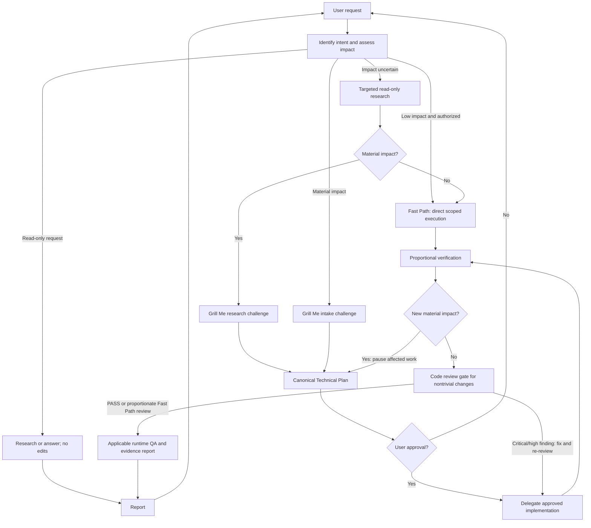

# Agent Handoff & Execution Architecture (v0.4)

> Status: **Draft**. This document defines proposed orchestration behavior, not an implemented runtime. See [README](../README.md).

## 1. Goal

Coordinate five portable roles (Orchestrator, Researcher, Coder, Code Reviewer, QA) using **Impact-Driven Planning**: low-impact authorized tasks take Fast Path without a plan, while material changes use one approved **Technical Implementation Plan** as the source of truth. Minimize redundant documents, conflicting edits, unverified completion claims, and uncontrolled rework.

## 2. Control plane and execution plane

- **Orchestrator is the control plane.** Owns user communication, research requests, plan approval, task assignment, dependency ordering, result aggregation, tracking, triage, and final reporting.
- **Specialists are the execution plane.** Receive a bounded assignment identified by a task ID *in the Technical Plan* for planned work, or a concise scoped instruction for Fast Path; report progress and evidence, but do not amend approved scope or approve their own work.
- **Researcher is read-only.** May be invoked before planning or again during triage when further codebase investigation is necessary.
- **Grill Me** is an Orchestrator-led challenge protocol at intake and after research, not a new approval authority. See [Grill Me](grill-me.md).
- **Code Reviewer** performs read-only static review on the integrated changes after automated checks and before QA. Critical/high findings must be fixed and re-reviewed. If host cannot launch a separate reviewer, disclose a sequential role-scoped pass.
- **QA is independent of implementation.** Validates running behavior and reports defects, not silent production-code fixes.
- **Human is the decision authority** for materially altered scope, major architecture changes, risky irreversible operations, and final release authorization where applicable.

## 3. Handoff protocol (no extra Task Contract document)

For planned work, the Orchestrator points the agent to the **approved plan version and assigned task IDs**. Fast Path uses a concise instruction covering scope, allowed action and expected verification, without inventing plan IDs. Neither approach creates a competing specification.

Each handoff identifies:

| Field | Meaning |
| --- | --- |
| Plan reference/version | Which agreed plan to follow, if applicable |
| Task IDs and owner | Exact planned work; IDs optional on Fast Path |
| Dependencies | What must be complete or available |
| Scope boundaries | Modules/files allowed and forbidden when known |
| Acceptance criteria | Relevant requirements in the plan |
| Worktree | Absolute path and branch for planned work (agents verify toplevel and branch before editing); N/A on Fast Path |
| Environment/tool access | What may actually be run |
| Expected evidence | Code diff, test output, logs, screenshots, repro, etc. |

Each agent reports back:

| Field | Meaning |
| --- | --- |
| Task ID | Link to plan when applicable, otherwise Fast Path request |
| Work status | TODO / IN_PROGRESS / BLOCKED / DONE / SKIPPED |
| Result summary | What actually changed or was investigated |
| Evidence | File references, diffs, test commands/results, logs, screenshots, or repro steps |
| Verification status | NOT_RUN / PASS / FAIL / BLOCKED, independently of work completion |
| Blockers / limitations | Missing tools, failed steps, unknowns, decisions needed |
| Recommended follow-up | Optional next action for the Orchestrator |

**No evidence means no verified claim.** Do not report tests as passed unless they were executed and results observed.

## 4. Execution sequence — Impact-Driven Planning

**Fast Path and Impact Gate:** The triggers live only in [SKILL.md](../SKILL.md) steps 3 and 5. When unsure, gate. If Fast Path execution reveals a trigger, stop before editing that area and re-route to a Technical Plan with user approval; do not silently expand scope. Production deployment, destructive actions and irreversible operations always retain their separate authorization requirements.

The diagram is conceptual. Host CLI support dictates whether genuine subagents or isolated environments are available.

## 5. Parallel execution rules

**Parallel is allowed only if all are true:**

1. Requirements, interface boundaries, and relevant acceptance criteria are sufficiently stable.
2. Neither task depends on the unfinished output of the other, or a stable contract exists for the dependency.
3. Write ownership is isolated (disjoint files/modules, dedicated branches/worktrees, or another supported isolation mechanism).
4. The selected CLI actually supports the intended parallel delegation, with adequate permissions.
5. The Orchestrator can reconcile both outputs and run integration checks before QA.

**Run sequentially if:**
- Both agents need to edit the same file or shared generated artifacts.
- Tests require a changing API/interface without an agreed contract.
- There is no safe isolation mechanism.
- An earlier task must finish to unblock the next task.
- Parallelism would cost more coordination than it saves.

**Default ownership:** A Coder owns the production code and test files/fixtures in its assigned scope. For high-risk areas the Orchestrator may add a second Coder in test-only mode that owns only test files and designs scenarios from acceptance criteria without reading the implementation. Shared config, snapshots, schemas, migrations, and lockfiles are coordinated by Orchestrator. No agent silently rewrites another's work. In a shared working tree, never concurrently edit overlapping areas.

Parallel work is not considered integrated until combined changes are checked for conflicts, test results are revalidated on the combined state, and the Orchestrator records the outcome.

## 6. Progress and verification

**Work statuses:** TODO, IN_PROGRESS, BLOCKED, DONE, SKIPPED.

**Verification statuses:** NOT_RUN, PASS, FAIL, BLOCKED.

- Agent updates on meaningful transitions: started, completed, blocked, and retest.
- Orchestrator alone consolidates task statuses into the Technical Plan when one exists; Fast Path may be reported directly.
- A Coder task may be DONE with verification NOT_RUN; it does **not** mean the feature is QA-approved.
- QA may finish its assigned validation task (DONE) while reporting verification FAIL and defects.
- A BLOCKED item includes reason and an owner/action to unblock.
- SKIPPED includes explicit justification.

Example (illustrative only):

| Task | Owner | Work | Verification | Evidence |
| --- | --- | --- | --- | --- |
| IMP-01 | Coder | DONE | PASS | Commit/diff + test files + unit-test log |
| IMP-02 | Coder (test-only) | DONE | PASS | Independent test files + run output |
| QA-01 | QA | DONE | FAIL | Reproduction steps + screenshot |
| IMP-03 | Coder | BLOCKED | NOT_RUN | Waiting for approved API decision |

## 7. Integration, code review and QA gates

Before QA, Orchestrator confirms a testable combined state and reports:
- Which changes are present and whether merge/file conflicts were resolved.
- Checks actually run (e.g., lint, typecheck, unit/integration tests, build).
- Known failures, missing checks, tool limitations, and the exact test target/environment.

For nontrivial changes, Code Reviewer must inspect the combined diff, relevant context and tests. Record reviewed ref, severity, file/symbol evidence and PASS/FAIL/BLOCKED/NOT_RUN separately from automated test results. CRITICAL/HIGH findings block QA and route back to implementation and review; MEDIUM requires a documented disposition. A separate agent is preferred but not guaranteed by the host. Trivial Fast Path changes may use proportional self-review.

QA validates against the **approved plan where one exists**, or explicitly requested Fast Path behavior, not just assertions or tests written by the Coder. Where supported, QA captures enough evidence to reproduce a defect. Evidence by change type (UI video, CLI-product video, backend integration/replay tests) is defined once in [QA](../agents/qa.md) and [Backend QA](backend-qa.md). When the required environment or tool is unavailable, report verification BLOCKED or NOT_RUN rather than PASS.

## 8. Finding and rework routing

A QA finding includes scenario, expected result, actual result, steps to reproduce, evidence, severity, and affected plan task/criterion when identifiable.

Orchestrator triages:

| Finding | Route |
| --- | --- |
| Production behavior defect | Coder (fix plus regression test), then QA retest |
| Missing/incorrect automated test | Coder (or a test-only Coder for high-risk areas) |
| Unknown current behavior or root cause | Researcher |
| Environment/tool unavailable | Unblock environment or report limitation |
| Requirement conflict or material design change | Discuss with user; update/re-approve Technical Plan |

Avoid endless retry loops. **After two failed fix/retest attempts on the same finding, require a root-cause review** rather than another unexamined patch. This is a review trigger, not a hard ban on further work.

**Review cycle cap:** a Code Reviewer FAIL, Coder fix and re-review is one cycle. Allow at most **2 cycles per task**. If the gate still FAILS after the second re-review, the Orchestrator stops the automatic loop, performs a root-cause review, and asks the user to decide: accept the risk with a documented disposition, change scope or design, direct a specific fix, or stop. Each cycle's findings and the `Review cycles used: N/2` count are recorded in the plan (or the final report on Fast Path).

## 9. Orchestrator final report

For each scoped deliverable, communicate:
- Implemented work and its linked plan task IDs, if applicable.
- Agent progress with work status and verification status separately.
- Actually executed checks and QA evidence.
- Remaining defects, risks, skipped work, and blockers.
- Decisions requiring user attention.
- Whether the result is ready for review, or why it is not.

Do not equate all tasks DONE with production-ready. Deployment/release requires its own permission and checks where appropriate.

## 10. Delegation drivers

For planned work the Orchestrator picks, in order: **Herdr** (automatic when `HERDR_ENV=1` and the official `herdr` skill is readable), host-native subagents, then sequential role-scoped execution.

With the Herdr driver each specialist is a separate CLI process in its own pane with **no shared conversation context**, so the handoff table in section 3 must be delivered as a self-contained prompt plus files, and the agent's report (same fields) is written to `.ai/runs/<plan-id>/<task-id>.md` and read back by the Orchestrator. Herdr lifecycle states are not verification; Orchestrator validates diff and evidence before recording statuses. Qark keeps approval, file ownership and verification authority; Herdr supplies only pane and process control. Full protocol: [Herdr driver](../integrations/herdr.md). Fast Path never spawns panes.

## 11. Portability rules

- Maintain these **logical contracts** independent of CLI vendor.
- Use host-native subagents when offered, otherwise sequential role-scoped execution.
- Do not imply real isolation, independent review, or parallel execution where unavailable.
- The installer/adapters (future work) map common roles and workflow to Codex, Gemini, and Claude capabilities.
- Keep credentials, local paths, or device-specific runtime details outside shared specifications.

## 12. Open design questions

1. Exact Technical Plan Markdown status layout and versioning policy.
2. How to store run evidence and screenshots without bloating the repository.
3. Which CLI isolation models can safely execute parallel tasks.
4. How much automatic rework is permitted before user involvement.
